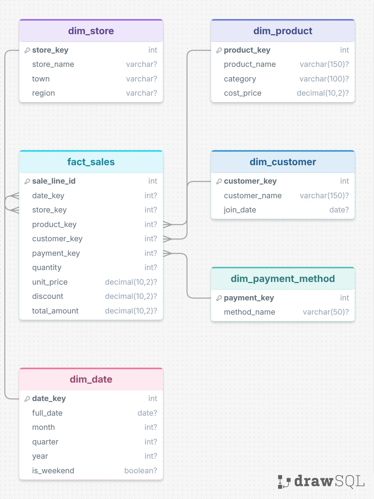
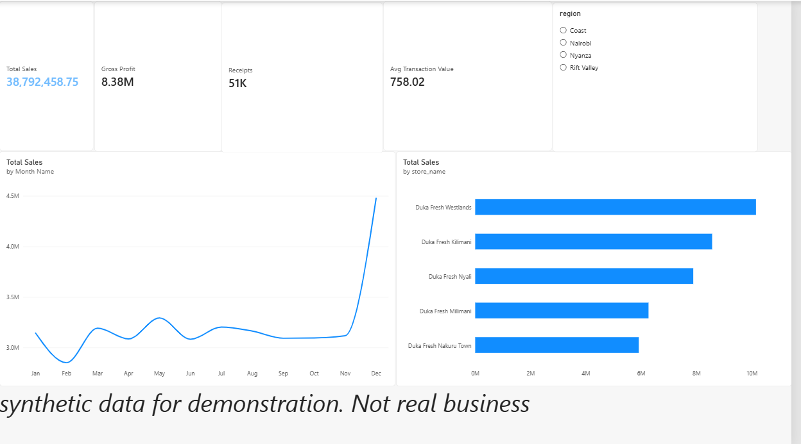
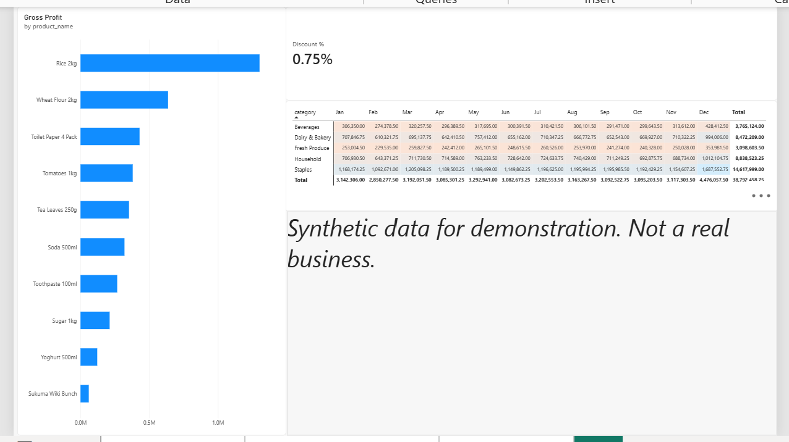
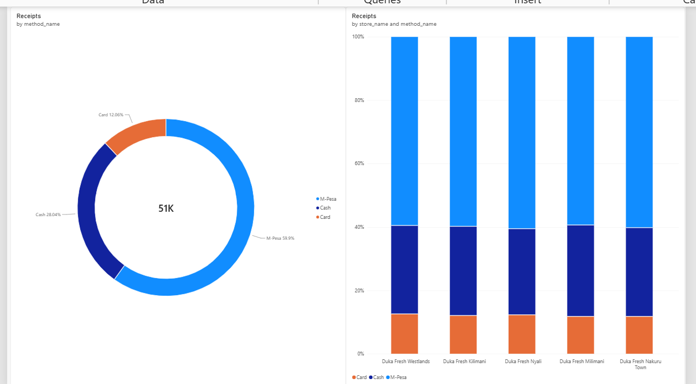

# Kenya Retail Data Warehouse

An end-to-end data pipeline and star-schema warehouse for a fictional Kenyan supermarket chain, **Duka Fresh**. Messy sales records go in; a tested, analysis-ready warehouse and a Power BI dashboard come out.

> **All data in this project is synthetic.** It was generated by the scripts in `src/` and does not describe any real business. Patterns in the results (for example the December peak) were programmed into the generator, so they illustrate the method and are not findings about Kenyan retail.

## Business problem

A retail chain records every sale at the till, but the raw records are not suitable for analysis: the same receipt can be sent twice, prices go missing, branch names are typed in different ways and dates arrive in different formats. Management needs one trustworthy source for questions such as:

- What are sales and gross profit by branch and month?
- Which products and categories earn the most?
- How do customers pay: M-Pesa, cash or card?
- How much do discounts cost?

## Architecture

```
generate data  ->  staging  ->  validate + clean  ->  star schema  ->  Power BI
(src/generate_*)  (raw text)   (clean / rejected)    (6 tables)       (3 pages)
```

| Stage | Script | What it does |
|---|---|---|
| Generate | `generate_reference_data.py`, `generate_sales_data.py` | Creates stores, products, customers and about 147,000 sales lines, with planted problems |
| Stage | `load_staging.py` | Copies the raw file into a text-only staging table, untouched. Safe to rerun |
| Clean | `clean_sales.py` + `sql/03` to `05` | Fixes what is certain, removes duplicates, rejects the rest with a reason |
| Load | `load_warehouse.py` + `sql/06` | Fills the star schema and checks row counts and totals |
| Test | `tests/test_warehouse.py` | 11 automated data quality checks |

## Tech stack

Python (pandas, SQLAlchemy), PostgreSQL, SQL (CTEs, window functions, ROLLUP, CUBE, GROUPING SETS), pytest, Power BI, Git and GitHub.

## Data model

A star schema with one fact table and five dimensions.



- **Grain of `fact_sales`:** one row per product line on one receipt.
- `receipt_id` and `line_no` are kept in the fact table so that receipt-level questions (average transaction value) can be answered.
- Shoppers without a customer ID are assigned customer key `0` ("Walk-in customer") so their sales are not lost in joins.

## Data quality results (measured)

These numbers come from running `src/clean_sales.py` and are stored in `docs/cleaning_summary.txt`.

| Step | Rows |
|---|---|
| Rows generated before damage | 146,073 |
| Duplicates planted | 1,461 |
| **Rows in staging** | **147,534** |
| Rejected: duplicate row | 1,461 |
| Rejected: missing unit price | 1,461 |
| Rejected: non-positive quantity | 723 |
| **Clean rows loaded to the warehouse** | **143,889** |

Planted problems that were **fixed, not rejected:** 2,921 misspelled store names, 4,382 dates in day/month/year format and 5,843 inconsistent payment labels. After cleaning, the data contains exactly 5 store names and 3 payment methods (checked by tests).

The generator planted 730 negative quantities but 723 were rejected. The 7-row difference is rows damaged twice, which received only their first matching reason (missing price).

**Rejection policy:** a value is only fixed when the fix is certain (spelling via a lookup table, date format). A missing price or a negative quantity cannot be repaired without guessing, so those rows are rejected and the reason is recorded.

## Tests

Eleven integration tests run against the loaded warehouse and all pass. They check that:

- clean rows plus rejected rows equal staging rows (nothing lost)
- there are no duplicate receipt lines and no invalid quantities or prices
- only the 5 official stores and 3 payment methods exist
- fact rows equal clean rows, and sales totals match to the cent
- every rejected row has a recorded reason

Run them with `python -m pytest -v`. They need the database to be loaded first.

## Dashboard

Three Power BI pages connected to the star schema. The dashboard totals were reconciled against SQL queries on the warehouse (total sales, gross profit, receipts, discount rate, payment mix).





Headline figures (synthetic data): total sales KES 38,792,458.75; gross profit KES 8,382,103.75; 51,176 receipts; average receipt KES 758.02; discounts 0.75% of pre-discount sales.

## How to run

Tested on Windows with PostgreSQL and Python 3.15. These steps have not yet been verified on a clean machine.

1. Clone the repository and create a virtual environment, then install packages:
   `python -m pip install -r requirements.txt`
2. Copy `.env.example` to `.env` and enter your PostgreSQL password.
3. In PostgreSQL, create the schema `"dukafresh-dw"`, then run `sql/01_create_tables.sql` and `sql/02_create_staging.sql` with that schema as the search path.
4. Run the pipeline in order:

```
python src/generate_reference_data.py
python src/generate_sales_data.py
python src/load_staging.py
python src/clean_sales.py
python src/load_warehouse.py
python -m pytest -v
```

5. Open `sql/07_analytics_queries.sql` to see the business questions answered in SQL.

## Repository structure

```
src/         pipeline scripts (generate, stage, clean, load)
sql/         table definitions, lookup maps, cleaning rules, analytics queries
tests/       data quality tests
dashboards/  Power BI page screenshots
docs/        business questions, star schema diagram, analysis notes
data/raw/    generated reference data and a 300-row sales sample
```

The full `sales_raw.csv` is not stored in the repository; recreate it with the generator.

## Limitations

- **Synthetic data:** seasonality (December and weekend boosts), product popularity and the identical payment mix across stores were programmed in.
- **Duplicate rule:** two rows with the same receipt and line number are treated as duplicates even if their content differs. The first copy is kept.
- **Date assumption:** dates written as `13/05/2025` are read as day/month/year.
- **Full reload:** each run empties and refills the tables. It is repeatable but not incremental.
- **Dimensions are overwritten**, not versioned (no slowly changing dimension history).
- **No returns:** negative quantities are treated as errors, so returns analysis is not possible.
- **Manual execution** and no continuous integration yet.
- The Power BI file is not stored in the repository.

## Future improvements

- Incremental loading and slowly changing dimension history for products
- Sales targets, inventory and payment-settlement tables to answer the remaining business questions (reconciliation of sales against settlements is the most valuable)
- Scheduling with Airflow, and Docker for one-command setup
- GitHub Actions to run the tests on every push

## Licence

MIT. See `LICENSE`.